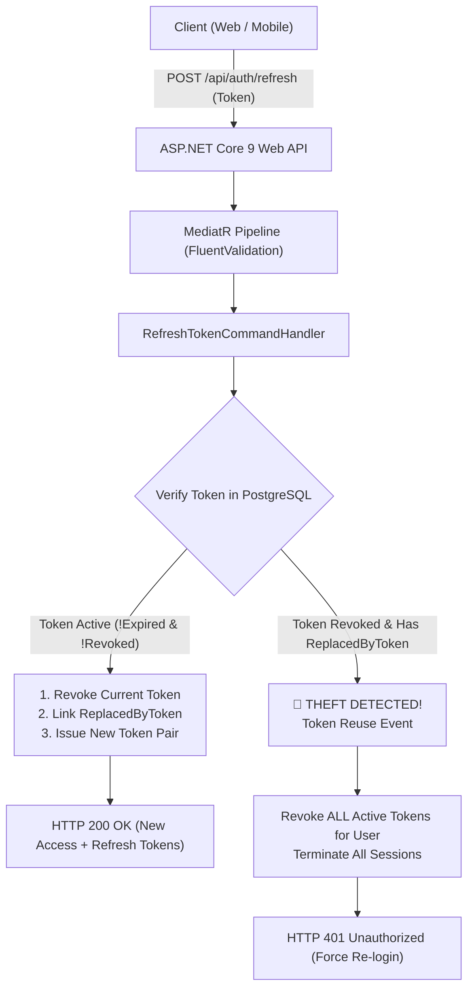

# SubFlow — Subscription & Billing Engine


A production-ready Fintech & SaaS subscription billing Web API built with **ASP.NET Core 9**, designed for high-security multi-tenant billing, automated subscription lifecycles, payment webhook idempotency, and **Refresh Token Rotation with Theft Detection**.

---

## 🎯 The Engineering Problem

Subscription management platforms and billing gateways face critical security and concurrency challenges that simple CRUD architectures cannot handle:

1. **Session Hijacking & Token Replay Attacks**: Standard JWT implementations leave users vulnerable when a long-lived refresh token is intercepted. Without automated theft detection, compromised sessions remain active until token expiration.
2. **Double Billing & Webhook Race Conditions**: Payment gateways (Stripe/Paddle) dispatch concurrent webhooks during network retries and invoice settlements. Without strict idempotency, customers risk duplicate charges and redundant subscription provisions.
3. **Subscription Lifecycle & Transition Integrity**: Managing state transitions (`Trialing` &rarr; `Active` &rarr; `PastDue` &rarr; `Canceled`) requires atomic database transactions and strict domain invariants to prevent unauthorized service access.

---

## 🛡️ Architectural Solution (Theft Detection & Security)

SubFlow implements an enterprise-grade **Two-Tier Authentication & Token Rotation Protocol (RFC 6819)**:



### Theft Detection Invariant:
When a valid refresh request arrives, the current token is immediately marked revoked and points to the newly issued token (`ReplacedByToken`). If a revoked token with an existing `ReplacedByToken` is received again, the system recognizes an intercepted token replay, immediately revoking **all** tokens for the affected user to isolate the breach.

---

## 📁 Project Structure

```text
SubFlow/
├── src/
│   └── SubFlow.Api/
│       ├── Controllers/                    # Thin API Controllers
│       ├── Domain/
│       │   ├── Entities/                   # Rich Domain Entities (User, RefreshToken)
│       │   └── Enums/                      # Domain Enums (UserRole, SubscriptionStatus)
│       ├── Features/                       # Vertical Slices / CQRS
│       │   └── Auth/                       # Login, Register, RefreshToken, Revoke
│       │       ├── Commands/               # MediatR Command definitions & Handlers
│       │       ├── Common/                 # DTOs & AuthResult models
│       │       └── Validators/             # FluentValidation rules
│       ├── Infrastructure/
│       │   ├── Persistence/                # EF Core AppDbContext & Migrations
│       │   │   └── Configurations/         # Fluent API database entity mapping
│       │   └── Services/                   # TokenService, PasswordHasher
│       ├── Program.cs                      # Dependency Injection & Middleware Pipeline
│       └── appsettings.json                # Configuration & Connection Strings
├── docker-compose.yml                      # PostgreSQL container orchestration
└── SubFlow.sln                             # Solution file
```

---

## 🚀 Getting Started

### Prerequisites

- [.NET 9.0 SDK](https://dotnet.microsoft.com/download/dotnet/9.0)
- [Docker Desktop](https://www.docker.com/products/docker-desktop) (or local PostgreSQL 16+)

### Quick Start

```powershell
# 1. Clone repository
git clone https://github.com/yandereye1/SubFlow.git
cd SubFlow

# 2. Start PostgreSQL via Docker
docker compose up -d

# 3. Apply EF Core Migrations
dotnet ef database update --project src/SubFlow.Api

# 4. Run the API
dotnet run --project src/SubFlow.Api
```

The Web API will launch with OpenAPI enabled.

---

## 👨‍💻 Author

GitHub: [@yandereye1](https://github.com/yandereye1)
